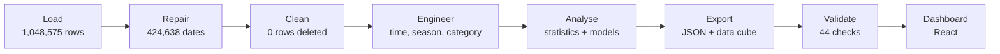

# Chicago Crime Analytics Dashboard

> ### 🏆 TECHVERSE 2026 · Grand Prize Winner
> **Ajeenkya DY Patil** · built by **Team Moleculens**

An interactive dashboard that turns **1,048,575 Chicago police crime reports** into clear, filterable answers.

**Live demo:** https://chicagocrime-data-analytics.vercel.app/

---

## Key figures

| Total crimes | Arrest rate | Domestic | Crime types | Crimes in 2016 | Average per month | Night-time | Violent |
|:-:|:-:|:-:|:-:|:-:|:-:|:-:|:-:|
| 1,048,575 | 20.5% | 18.3% | 33 | 268,944 | 22,421 | 17.7% | 29.2% |

---

## Features

**Dashboard**
All 8 KPIs and 10 required charts on one page. Four filters (crime type, district, arrest, domestic) update every number at once.

**Story**
Findings written as short chapters: summer has 17% more crime per day than winter, and weekend nights run 69% above weekday nights.

**Fair arrest analysis**
Arrest rates adjusted for crime type show that 86% of the evening-versus-night gap comes from what was reported, not the time of day.

**District map**
About 2,400 map patches coloured by police district, with a detail panel for each district showing totals, top crime types and arrest rate against expectation.

**Detective Dot**
A built-in assistant that answers questions from the project's own analysis and recalculates live on the filtered data.

**Data Trust**
Every cleaning step, metric definition, method and limitation in one place. 424,638 swapped dates were repaired and no rows were deleted.

---

## Data

Supplied by the TECHVERSE organisers; it appears to be an extract of the City of Chicago "Crimes - 2001 to Present" data.

`1,048,575 records` · `22 columns` · `33 crime types` · `24 districts` · `2001 - 2026`

Column types: 4 integer, 6 decimal, 8 text, 2 date-time, 2 boolean. Missing values: coordinates 31%, community area 2%, ward 2%, location description 1%.

---

## Data pipeline

---

## Tech stack

**Analysis:** Python, pandas, NumPy, SciPy, scikit-learn, PyArrow, Pydantic

**Dashboard:** React, TypeScript, Vite, Motion, d3, SVG and Canvas

**Hosting:** Vercel

---

## Copyright

Copyright (c) 2026 Team Moleculens. All rights reserved.
