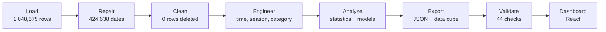

# Chicago Crime Analytics Dashboard

> ### 🏆 TECHVERSE 2026 · Grand Prize Winner
> **Ajeenkya DY Patil** · built by **Team Moleculens**

Live demo: **https://chicagocrime-data-analytics.vercel.app/**

---

## Overview

An interactive dashboard that turns **1,048,575 Chicago police crime reports** into answers. Every number comes from a Python analysis, every chart can be filtered, and every finding states its method and its limits.

It is easy to start (all 8 KPIs and 10 charts are on one page), easy to explore (four filters update everything at once), and easy to trust (a Data Trust section shows exactly how each number was made).

---

## Data pipeline

---

## Data

| | |
|---|---|
| **Source** | Crime reports supplied by the TECHVERSE organisers (appears to be an extract of the City of Chicago "Crimes - 2001 to Present" data) |
| **Records** | 1,048,575 (one row per reported crime) |
| **Columns** | 22 in the original file, 33 after cleaning and feature engineering |
| **Period** | 2001 to 2026 (dense coverage: Apr 2015 - Jul 2017 and Oct 2025 - Aug 2026) |
| **Categories** | 33 crime types, 24 police districts, 306 police beats |

**Data types (22 original columns)**

| Type | Columns | Fields |
|---|---|---|
| Integer | 4 | ID, Beat, District, Year |
| Decimal | 6 | Latitude, Longitude, X Coordinate, Y Coordinate, Ward, Community Area |
| Text | 8 | Case Number, Block, IUCR, Primary Type, Description, Location Description, FBI Code, Location |
| Date-time | 2 | Date, Updated On (stored as a mix of text and Excel dates, repaired) |
| Boolean | 2 | Arrest, Domestic |

**Missing values:** coordinates 31.3%, community area 1.8%, ward 1.6%, location description 0.8%. No other column has gaps.

---

## Key figures

| Total crimes | Arrest rate | Domestic | Crime types | Crimes in 2016 | Average per month | Night-time | Violent |
|:-:|:-:|:-:|:-:|:-:|:-:|:-:|:-:|
| 1,048,575 | 20.5% | 18.3% | 33 | 268,944 | 22,421 | 17.7% | 29.2% |

---

## What we built

| Feature | What we did | Result |
|---|---|---|
| **Dashboard** | All 8 competition KPIs and 10 required charts on one page, with 4 filters (crime type, district, arrest, domestic) that recalculate every number together | 8 KPIs, 10 charts, one consistent set of numbers |
| **Story** | Compared time, arrests and places with confidence ranges and mix-adjusted rates | Summer has 17% more crime per day than winter (788 vs 674). Weekend nights run 69% above weekday nights. |
| **Fair arrest analysis** | Standardised arrest rates for crime type, then tested a model on months it had never seen | The evening-vs-night arrest gap falls from 7.3 to 1.0 points once crime type is accounted for (86% explained). Model score: AUC 0.86. |
| **District map** | Coloured about 2,400 map patches (~550 m) by their police district's crimes, arrest rate, violent, domestic or night share | District 11 has the most crimes (69,214) and a 38.3% arrest rate, but its index is 0.98, so its crime mix explains the rate. |
| **Detective Dot** | A built-in assistant that answers from the project's own analysis and recalculates live on the filtered data | Compares crime types or districts, explains any chart, and never invents numbers |
| **Data Trust** | Documented the source, every cleaning step, metric definitions, methods and limitations | 424,638 swapped dates repaired, 0 rows deleted, 44 automated checks passed |

---

## Tech stack

| Area | Technology |
|---|---|
| Analysis | Python 3.13, pandas, NumPy, SciPy, scikit-learn |
| Data handling | openpyxl, PyArrow (Parquet), Pydantic |
| Dashboard | React, TypeScript, Vite |
| Visualisation | Hand-built SVG and Canvas, d3 (scales and shapes) |
| Motion | Motion (animation library) |
| Typography | Bricolage Grotesque, Inter, JetBrains Mono |
| Hosting | Vercel |

---

## Copyright

Copyright (c) 2026 Team Moleculens. All rights reserved.

No part of this project may be copied, modified, distributed or used without prior written permission from the authors.
