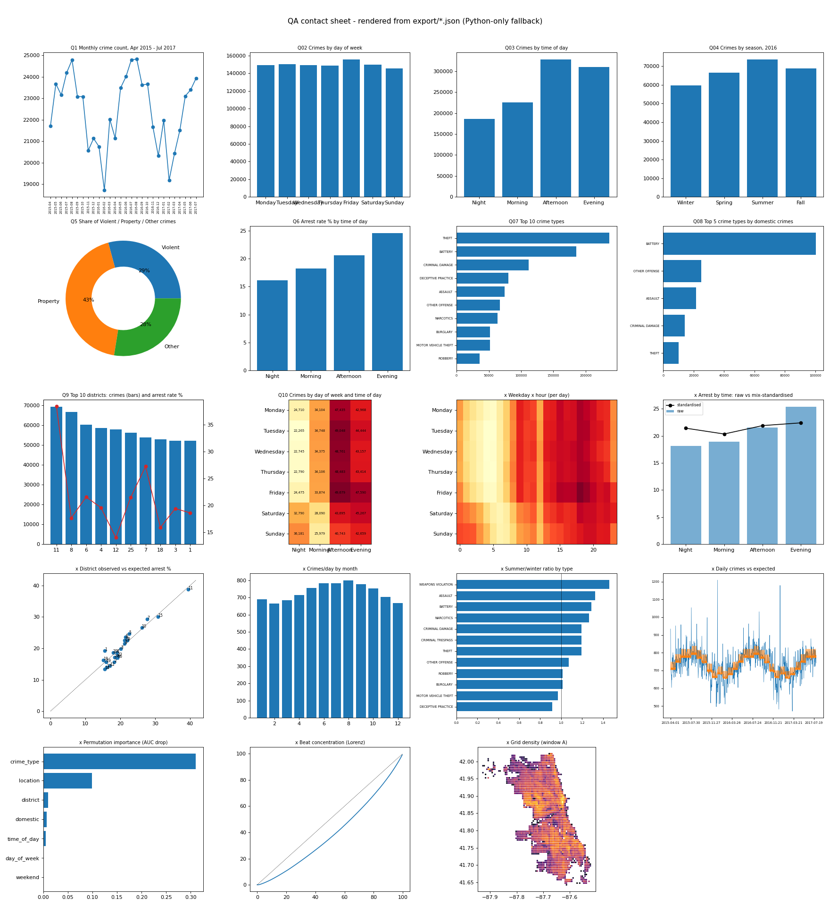

# Chicago Crime Branch

> ### 🏆 TECHVERSE 2026 · Grand Prize Winner
> **Ajeenkya DY Patil** · built by **Team Moleculens**

An interactive data story built on **1,048,575 Chicago police crime reports**. A Python pipeline cleans the data and works out every number; a React dashboard lets you explore the results, filter them, map them and ask questions about them.

Everything on screen is computed from the data. Nothing is typed in by hand.



---

## What it does

### 1. A welcome page with a story
A night-city scene opens the project: a moving skyline, drifting crime-scene tape, a police-light glow and a flashlight that follows your cursor over the real crime map.

### 2. The 8 KPI cards and 10 required charts
All competition deliverables are on one **Dashboard** page, labelled with their handout numbers.

| KPI | Result |
|---|---|
| K1 Total crimes | 1,048,575 |
| K2 Arrest rate | 20.5% |
| K3 Domestic crime | 18.3% |
| K4 Different crime types | 33 |
| K5 Crimes in 2016 | 268,944 |
| K6 Average per month (Apr 2015 – Jul 2017) | 22,421 |
| K7 Night-time crime (00:00 – 05:59) | 17.7% |
| K8 Violent crime | 29.2% |

Charts Q1–Q10 cover monthly trend, weekday, time of day, season, violent / property / other share, arrest rate by time, top crime types, top domestic types, districts with arrest rate, and a weekday × time heat map.

### 3. Filters that change everything at once
Filter by **crime type**, **district**, **arrest** and **domestic**. Every card, chart and map recalculates together from one compact data cube, so the numbers always agree. Clicking bars in Q7, Q8 and Q9 filters the page too.

### 4. A district map
About 2,400 patches of the city (~550 m each) are coloured by their police district's crimes, arrest rate, violent, domestic or night share. Pick a district to see its totals, its top crime types and whether its arrest rate is above or below what its crime mix predicts.

### 5. A Story tab with deeper analysis
- **When:** summer has about 17% more crime than winter; weekend nights run about 69% above weekday nights.
- **Arrests:** most of the "evenings have more arrests" gap disappears once you account for the type of crime.
- **What & where:** domestic crime is led by battery; crime is spread widely, but each district has its own signature.
- **Then vs now:** daily crime in 2025–26 is about 14% below 2015–17 (two periods, not a trend).

### 6. A Data trust tab
Source, pipeline, metric definitions, methods, data-quality findings, the cleaning log, assumptions and limitations, so a first-time viewer can see exactly how the numbers were made.

### 7. Detective Dot, the built-in assistant
Ask in plain language: "What is a KPI?", "Compare theft and battery", "Tell me about District 11", "Which month had the most crime?". Dot answers from the project's own analysis and recalculates live on the same data, so answers follow your filters. It is rule-based, not a general AI, and it says so.

---

## How it works

```
Crime Dataset.xlsx  →  load  →  clean  →  add columns  →  analyse  →  export  →  validate
                                                                          │
                                                                          ▼
                                                              JSON files + data cube
                                                                          │
                                                                          ▼
                                                              React dashboard (this repo's /dashboard)
```

1. **Load** the Excel file in read-only mode (never modified, checked with a SHA-256 fingerprint).
2. **Repair dates.** Excel had swapped month and day on 424,638 dates; they are swapped back and proven correct three ways.
3. **Clean** impossible coordinates and empty values. No rows are deleted and no values are guessed.
4. **Add columns** with the handout's exact rules: time of day, season, violent / property / other.
5. **Analyse** with confidence ranges, fair (standardised) comparisons, models tested on unseen months, and anomaly checks.
6. **Export** JSON files and a small data cube.
7. **Validate** with 44 automatic checks (handout values reproduced, totals add up, sort orders correct, cube equals raw data).

The dashboard repeats a self-check on load and shows a "Verified" badge when its maths matches Python's.

---

## Tech stack

| Layer | Tools |
|---|---|
| Analysis | Python 3.13, pandas, NumPy, SciPy, scikit-learn, PyArrow, openpyxl |
| Checks | Pydantic (data contracts), custom validation suite |
| Dashboard | React, TypeScript, Vite |
| Motion & charts | Motion, d3 (scales and shapes), hand-built SVG and Canvas |
| Fonts | Bricolage Grotesque, Inter, JetBrains Mono |

There is no server or database: the pipeline runs once and the site is fully static, so it works offline.

---

## Getting started

### Run the dashboard
```bash
cd dashboard
npm install
npm run dev
```
Open http://localhost:5173.

### Rebuild the analysis (optional)
The cleaned data is already included. To regenerate it, place `Crime Dataset.xlsx` one level above this folder, then:
```bash
pip install -r requirements.txt
python run_all.py
```
The first run reads the 150 MB workbook (about 4 minutes) and then caches it.

### Useful commands (inside `dashboard/`)
| Command | What it does |
|---|---|
| `npm run dev` | Start the site locally |
| `npm run build` | Make a production build in `dist/` |
| `npm run verify` | Prove the site's maths equals the Python export |

---

## Project structure

```
.
├── run_all.py        # one command: load → clean → analyse → export → validate
├── src/              # Python pipeline (clean, features, stats, models, export, validate)
├── export/           # JSON the website reads
├── reports/          # analysis report, PDFs and a chart contact sheet
├── tests/            # pytest wrapper around the validation checks
└── dashboard/        # React + TypeScript website
    ├── src/lib/          # data engine, assistant (Dot), helpers
    ├── src/charts/       # hand-built SVG charts
    ├── src/components/   # welcome, map, data trust, chat, cards, filters
    └── scripts/          # data sync and verification
```

---

## About the data

The workbook is supplied by the TECHVERSE organisers and is **not included** in this repository. It appears to be an extract of the City of Chicago "Crimes – 2001 to Present" data. It holds exactly Excel's row limit, so it is a slice of the full table: only **Apr 2015 – Jul 2017** and **Oct 2025 – Aug 2026** are densely filled, and the analysis never claims multi-year trends.

## Limitations

- The file is a slice, so there are no long-term trend claims.
- There is no population data, so there are no per-capita claims.
- 2025–26 has almost no map coordinates, and its arrest rate is probably understated because later arrests are not yet recorded.
- The models show association, not cause.
- Dot is rule-based and only knows this project.

---

**TECHVERSE 2026 Grand Prize Winner · Ajeenkya DY Patil · Team Moleculens**
